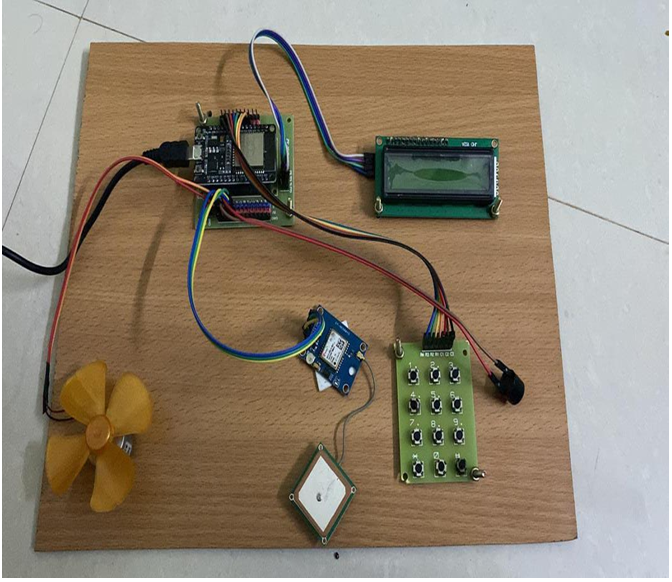
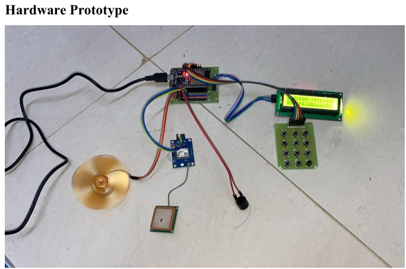
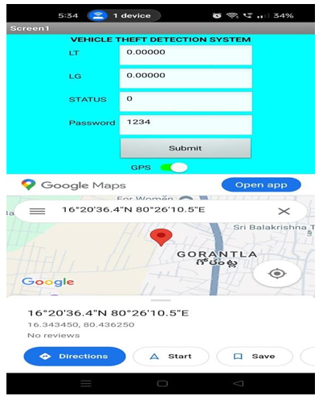

# 🚗 IgniSecure — IoT-Based Smart Vehicle Immobilizer & Theft Alert System

<p align="center">


</p>

<p align="center">
  <b>A low-cost IoT security prototype designed to prevent unauthorized vehicle access, immobilize the vehicle, and provide real-time location monitoring.</b>
</p>

---

## 📌 Overview

**IgniSecure** is an IoT-enabled vehicle security and anti-theft prototype that combines **password-based authentication, vehicle immobilization, GPS tracking, Wi-Fi connectivity, cloud monitoring, and theft alerts** into a single system.

The system is built around an **ESP32 microcontroller** and is designed to provide an additional layer of security for vehicles by preventing unauthorized users from starting the vehicle.

When an authorized password is entered, the system permits vehicle operation. If unauthorized access is detected, the system can activate an alert and keep the vehicle immobilized. GPS information can also be transmitted to the cloud for remote monitoring.

The project focuses on creating a **practical, affordable, and extensible IoT-based vehicle security solution** using readily available hardware.

---

## 🎯 Problem Statement

Conventional vehicle security mechanisms such as physical keys and basic alarms may not provide sufficient protection against unauthorized access or vehicle theft.

A smarter security mechanism can combine:

- 🔐 User authentication
- 🚫 Vehicle immobilization
- 📍 Location tracking
- ☁️ Cloud-based monitoring
- 🚨 Unauthorized-access alerts

**IgniSecure** integrates these capabilities into one IoT-based prototype.

---

## 💡 Proposed Solution

The system follows a multi-stage security mechanism:

```text
                 ┌─────────────────────┐
                 │     System ON       │
                 └──────────┬──────────┘
                            │
                            ▼
                  ┌──────────────────┐
                  │  ESP32 Startup   │
                  └────────┬─────────┘
                           │
                           ▼
                  ┌──────────────────┐
                  │ Password Input   │
                  └────────┬─────────┘
                           │
                    ┌──────▼──────┐
                    │ Authenticated?│
                    └───┬──────┬───┘
                        │      │
                      YES      NO
                        │      │
                        ▼      ▼
              ┌────────────┐  ┌─────────────┐
              │ Enable     │  │ Keep Vehicle│
              │ Vehicle    │  │ Immobilized │
              └─────┬──────┘  └──────┬──────┘
                    │                │
                    ▼                ▼
             ┌────────────┐    ┌────────────┐
             │ GPS Data   │    │ Alert /    │
             │ Collection │    │ Buzzer     │
             └─────┬──────┘    └────────────┘
                   │
                   ▼
             ┌────────────┐
             │ ThingSpeak │
             │ Monitoring │
             └────────────┘
```

---

## ✨ Key Features

### 🔐 Secure Authentication
Password-based authentication is used to control access to the vehicle prototype.

### 🚫 Vehicle Immobilization
The system can prevent the motor from operating when unauthorized access is detected.

### 📍 GPS-Based Tracking
A GPS module provides vehicle location information for monitoring.

### ☁️ Cloud Monitoring
Vehicle-related data can be transmitted to **ThingSpeak** for remote monitoring.

### 📶 Wi-Fi Connectivity
The ESP32 provides wireless connectivity between the prototype and cloud services.

### 🚨 Theft Alert
An active buzzer provides a local alert when unauthorized access is detected.

### 📺 Real-Time Status Display
An LCD displays authentication and vehicle status information.

### 💰 Low-Cost Prototype
The system uses commonly available IoT and embedded components, making it suitable for educational and prototype applications.

---

## 🧰 Hardware Components

| Component | Function |
|---|---|
| **ESP32** | Main processing and Wi-Fi controller |
| **Neo-6M GPS Module** | Vehicle location tracking |
| **4×3 Matrix Keypad** | Password input |
| **16×2 LCD** | Displays system and authentication status |
| **Relay Module** | Controls vehicle motor circuit |
| **DC Motor** | Represents the vehicle motor in the prototype |
| **Active Buzzer** | Unauthorized-access alert |
| **Breadboard** | Prototype circuit assembly |
| **Jumper Wires** | Component connections |

---

## 💻 Software & Technologies

- **Arduino IDE**
- **Embedded C / Arduino Programming**
- **ESP32**
- **IoT**
- **ThingSpeak**
- **GPS**
- **Wi-Fi**
- **Google Maps**
- **LCD Interface**
- **Keypad Authentication**

---

## 📂 Repository Structure

```text
IgniSecure-Smart-Vehicle-Immobilizer-Iot
│
├── Arduino_Code
│   ├── ignisecure.ino
│   ├── libraries.txt
│   └── connections.md
│
├── Components
│   └── components.md
│
├── Block_Diagram
│   └── block-diagram.png
│
├── Circuit_Diagram
│   └── circuit-diagram.png
│
├── Images
│   ├── hardware-prototype.png
│   ├── working-prototype.png
│   ├── gps-tracking.png
│   └── Images.md
│
└── README.md
```

---

## 🔄 System Workflow

The complete system operates through the following sequence:

**1. System Initialization**

The ESP32 initializes the connected sensors, display, keypad, GPS module, and communication components.

**2. User Authentication**

The user enters a password through the keypad.

**3. Authentication Decision**

- Correct password → Vehicle operation is enabled.
- Incorrect/unauthorized access → Vehicle remains immobilized and an alert is generated.

**4. Vehicle Monitoring**

Once the vehicle system is active, GPS data can be collected for location tracking.

**5. Cloud Communication**

Relevant data is transmitted through Wi-Fi to the ThingSpeak platform.

**6. Remote Monitoring**

The collected information can be viewed remotely for monitoring purposes.

---

## 📸 Prototype

### 🔧 Hardware Setup



### 🚗 Working Prototype



### 📍 GPS Tracking



---

## 🏗️ System Architecture

```text
                    ┌─────────────────┐
                    │     Keypad      │
                    │ Authentication  │
                    └────────┬────────┘
                             │
                             ▼
┌──────────────┐      ┌───────────────┐      ┌──────────────┐
│   GPS Module │─────▶│     ESP32     │─────▶│ Relay / Motor│
└──────────────┘      │   Controller  │      └──────────────┘
                      └───────┬───────┘
                              │
                    ┌─────────┴─────────┐
                    │                   │
                    ▼                   ▼
             ┌────────────┐      ┌────────────┐
             │    LCD     │      │   Buzzer   │
             │   Display  │      │   Alert    │
             └────────────┘      └────────────┘
                              │
                              ▼
                       ┌─────────────┐
                       │  Wi-Fi /    │
                       │ ThingSpeak  │
                       └─────────────┘
```

---

## 🌐 IoT & Cloud Integration

The ESP32 acts as the central IoT controller and communicates with the cloud through Wi-Fi.

**Data flow:**

```text
Vehicle Prototype
       ↓
     ESP32
       ↓
     Wi-Fi
       ↓
 ThingSpeak Cloud
       ↓
Remote Monitoring
```

This architecture enables the prototype to extend beyond a locally controlled security system toward a connected vehicle-monitoring solution.

---

## 🔐 Security Mechanism

IgniSecure uses multiple layers of protection:

| Security Layer | Purpose |
|---|---|
| Password Authentication | Restricts unauthorized vehicle access |
| Vehicle Immobilization | Prevents motor operation |
| Buzzer Alert | Provides local unauthorized-access notification |
| GPS Tracking | Provides vehicle location information |
| Cloud Monitoring | Enables remote observation |

The combination of these mechanisms provides a multi-layered approach to vehicle security.

---

## 🚀 Future Enhancements

The current prototype can be extended with additional security and automation capabilities:

- 📱 Dedicated Android/iOS monitoring application
- 📩 SMS-based theft notifications
- 📷 Camera-based verification
- ☁️ Firebase-based real-time monitoring
- 🔑 Fingerprint authentication
- 👤 Face recognition
- 🛰️ Enhanced GPS tracking
- 🤖 AI-based suspicious-activity detection
- 📊 Historical vehicle movement analytics
- 🔔 Mobile push notifications
- 🔋 Battery and power-status monitoring

---

## 🎯 Potential Applications

IgniSecure can be adapted for:

- 🚗 Personal vehicle security
- 🏍️ Two-wheeler security
- 🚚 Fleet monitoring
- 🅿️ Smart parking systems
- 🏫 Educational IoT prototypes
- 🚛 Commercial vehicle monitoring
- 🌐 Smart transportation systems
- 🏘️ Rural vehicle security

---

## 📊 Project Highlights

| Category | Implementation |
|---|---|
| Controller | ESP32 |
| Authentication | Keypad + Password |
| Tracking | Neo-6M GPS |
| Communication | Wi-Fi |
| Cloud Platform | ThingSpeak |
| Vehicle Control | Relay + DC Motor |
| Alert System | Active Buzzer |
| Display | 16×2 LCD |
| Development Environment | Arduino IDE |

---

## 👩‍💻 Author

### Navya Lakshmi Manda

**B.Tech – CSE(CIC)**


---

## 📌 Project Type

**Academic / IoT Prototype Project**

Developed as a practical implementation of IoT-based vehicle security, embedded systems, cloud connectivity, and real-time monitoring.

---

<p align="center">


</p>